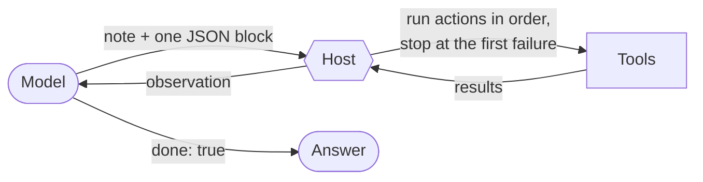

<div align="center">


# TAP

**The Text Action Protocol. Tool use for any model, in plain text.**

A model writes a short note and one fenced JSON block. The host runs the actions and sends back the results.<br>
No native tool-calling API. Works with any chat model, including small, cheap and self-hosted ones.

[](LICENSE)
[](SPEC.md)
[](conformance)

[Spec](SPEC.md) · [Conformance](conformance) · [TypeScript](packages/ts) · [Python](packages/python) · [Examples](examples)

</div>

---

## What it looks like

The model replies with a sentence of reasoning and exactly one fenced JSON block:

````
I'll fix the off-by-one and run the tests.
```json
{"say": "Fixing parseWeek.",
 "actions": [{"tool": "edit_file", "args": {"path": "src/date.ts", "find": "return week", "replace": "return week - 1"}},
             {"tool": "shell", "args": {"command": "npm test"}}],
 "done": false}
```
````

The host runs the actions in order, stops at the first failure, and answers with one observation:

```
<observation step="2">
results of your actions:
- edit_file src/date.ts → ok: 1 replacement
- shell npm test → ok: 12 passed
</observation>
```

The loop repeats until the model replies with `"done": true`.



## Why a text protocol

|  | Native tool calling | TAP |
|---|---|---|
| **Round trips** | Often one call per turn | One reply can hold a batch: read three files, or edit and then run the tests |
| **Prompt size** | A JSON schema for every tool on every request | A short text catalog, identical each turn, so it caches |
| **Model support** | Only models that implement it well | Any model that can follow a format |

Native tool calling is the better choice when your model supports it well and one call per turn is fine. TAP is for when you want batches, a small prompt, or a model with no tool calling at all.

## Imperfect models are expected

Models drop commas, forget a brace, write Python `True`, or keep going and invent the next observation. The spec says exactly how a host should read those replies, and the test suite pins it down. Every example below is a real case from [`conformance/vectors.json`](conformance/vectors.json).

**Python literals.** This reply is not valid JSON:

````
```json
{"say": "Turning on the flag.", "actions": [{"tool": "edit_file", "args": {"path": "config.py", "find": "enabled = False", "replace": "enabled = True", "dry_run": False}}], "done": True}
```
````

TAP reads it as one `edit_file` action with `dry_run: false` and `done: true`. Only the JSON syntax is repaired. The file contents inside the strings (`enabled = True`) are never touched.

**A model that writes its own observation.** After its block, the model invents what happens next:

````
```json
{"say": "Running the tests.", "actions": [{"tool": "shell", "args": {"command": "npm test"}}], "done": false}
```

<observation step="2">
results of your actions:
- shell npm test -> ok: 12 passed
</observation>

```json
{"say": "All tests pass.", "actions": [], "done": true}
```
````

Only the first block runs, and the parser reports `ignoredBlocks: 1` so the host can tell the model off. Nothing the model imagined is acted on.

The same goes for trailing commas, comments, curly quotes, raw newlines inside strings, missing closing braces, replies cut off mid-way, code fences that hold other code, and more. See [section 6 of the spec](SPEC.md#6-reading-replies-parsing).

## Use it

TypeScript:

```bash
npm install @heurica/tap
```

```ts
import { parse } from "@heurica/tap";

const result = parse(modelText);
if (result.ok) {
  for (const action of result.reply.actions) console.log(action.tool, action.args);
} else {
  console.log(result.error.kind); // "no_json" or "invalid_json"
}
```

Python:

```bash
pip install heurica-tap
```

```python
from heurica_tap import parse

result = parse(model_text)
if result.ok:
    for action in result.reply.actions:
        print(action.tool, action.args)
```

Both libraries also include an observation formatter, a tool catalog renderer, a ready-made briefing for the model, and a small agent loop. There are no runtime dependencies. See the [TypeScript](packages/ts) and [Python](packages/python) READMEs for a full agent, and [`examples/`](examples) for one that talks to any OpenAI-compatible endpoint.

## What is in this repository

| | |
|---|---|
| [`SPEC.md`](SPEC.md) | The protocol: reply format, execution rules, observations, lenient parsing, error feedback, the tool catalog |
| [`conformance/`](conformance) | 150 test vectors. Raw model text in, exact parse result out |
| [`packages/ts`](packages/ts) | `@heurica/tap` for TypeScript and JavaScript |
| [`packages/python`](packages/python) | `heurica-tap` for Python |
| [`schema/`](schema) | JSON Schemas for the reply and the tool catalog |
| [`examples/`](examples) | A minimal agent for any OpenAI-compatible endpoint, in both languages |
| [`tools/oracle/`](tools/oracle) | The program that generated the vectors from Anvil's parser |

## How it relates to MCP

TAP is about the format of the conversation between a model and its host. It does not replace MCP, which is about how a host connects to tool servers. A host can use TAP with the model and MCP behind its handlers.

## Conformance

An implementation conforms if it passes every vector in [`conformance/vectors.json`](conformance/vectors.json). A vector is a raw model reply and the exact result a parser must produce, so a new language port can check itself without reading the spec twice. Four vectors are marked `divergesFromAnvil`: they are cases where the reference parser in Anvil is wrong and the spec is stricter. See [`conformance/QUIRKS.md`](conformance/QUIRKS.md).

## Where it comes from

TAP was extracted from [Anvil](https://github.com/heurica-labs/anvil), a native macOS coding agent that runs it against many different models. The spec describes what Anvil's parser actually does, and the vectors were generated by running that parser.

## Status

Version 0.1, a draft. The format may still change before 1.0, and each change is noted in the [changelog](CHANGELOG.md). A failing vector or a reply that a real model produced and the spec cannot read is the best bug report. Please open an issue with the raw text.

## License

MIT. See [LICENSE](LICENSE).

<div align="center">
<br>
<sub>Built by <a href="https://heurica.dev">Heurica</a></sub>
</div>
